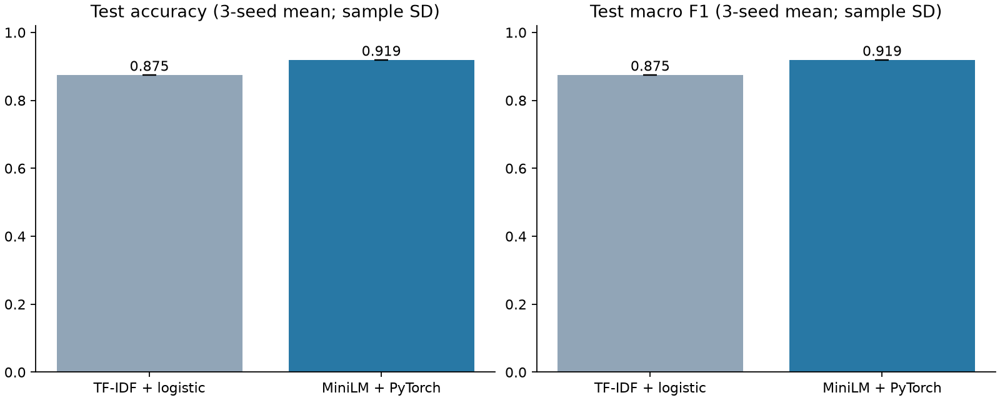
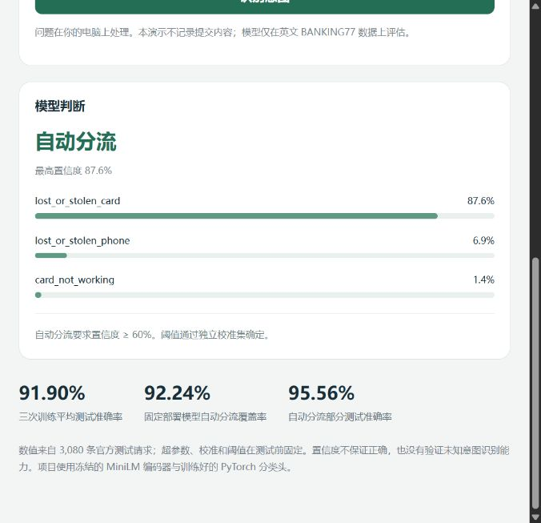
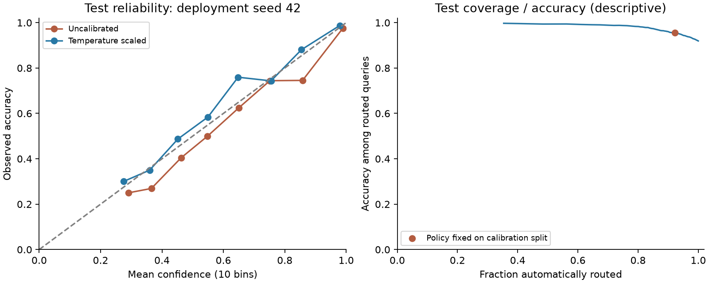

## 已完成的真实结果

官方 BANKING77 测试集共 3,080 条英文银行客服问题、77 个意图。

| 模型 | Accuracy | Macro F1 |
|---|---:|---:|
| TF-IDF + Logistic Regression | 87.47% | 0.8749 |
| MiniLM + PyTorch，三种子平均 ± 样本标准差 | 91.90% ± 0.05 个百分点 | 0.9189 ± 0.0004 |
| 固定部署 seed 42 | 91.95% | 0.9193 |

三种子平均准确率高于基线 **4.44 个百分点**。部署种子预先固定为 42，其准确率差为 **4.48 个百分点**，按查询成对 bootstrap 的 95% 区间为 **[3.25, 5.58] 个百分点**。种子间波动和 bootstrap 区间衡量不同来源的不确定性。

部署模型以独立校准集选择的 `0.60` 为阈值：测试自动分流覆盖率 **92.24%**，自动分流部分准确率 **95.56%**，其余 **7.76%** 转人工。这里的“自动分流”指意图标签路由，实际没有连接人工客服平台。



详细结果见 [实验报告](reports/RESULTS.md)、[机器可读指标](reports/summary.json)、[模型验证](reports/verification.json)。

## Windows 快速开始

使用 Python 3.12，进入本项目目录，执行：

```powershell
python -m venv .venv
.\.venv\Scripts\python.exe -m pip install -r requirements.txt
.\.venv\Scripts\python.exe prepare_model.py
.\.venv\Scripts\python.exe predict.py --text "I lost my card. How can I freeze it?"
```

`prepare_model.py` 从官方 Hugging Face 下载固定版本编码器，约 91 MB 权重，并校验上游 SHA256。下载一次后可离线推理；使用包含 `models/minilm/` 的完整离线资源包时可跳过这一步。已保存的分类头在 `artifacts/` 中，演示不需要训练或下载 BANKING77 原始数据。

### 网页演示

```powershell
.\.venv\Scripts\python.exe serve.py
```

看到 `Ready` 后访问 **http://127.0.0.1:7862**。按 Ctrl+C 关闭服务。网页只有本地服务运行时可用，GitHub 仓库页面不会运行 Python 模型。

输入英文问题，例如：

```text
I lost my card. How can I freeze it?
Why is my transfer still pending?
I was charged twice for the same purchase.
I need help with my account.
```

模型返回前三个意图、校准置信度和分流判断。只含中文等不含英文字符的输入直接交给人工；这条简单规则不是完整语言检测。含英文的其他语言或混合语言没有验证。



### JSON 接口

```powershell
Invoke-RestMethod -Uri http://127.0.0.1:7862/health
Invoke-RestMethod -Uri http://127.0.0.1:7862/predict -Method Post -ContentType 'application/json' -Body '{"text":"Why is my transfer still pending?"}'
```

## 从头复现

```powershell
.\.venv\Scripts\python.exe download_data.py
.\.venv\Scripts\python.exe prepare_model.py
.\.venv\Scripts\python.exe run_experiment.py --device cpu
.\.venv\Scripts\python.exe -m unittest discover -s tests -v
.\.venv\Scripts\python.exe verify_project.py
.\.venv\Scripts\python.exe verify_api.py
.\.venv\Scripts\python.exe benchmark.py --device cpu
```

如要使用 NVIDIA 显卡，安装本次实际使用的兼容构建，先检查 CUDA，再运行实验：

```powershell
.\.venv\Scripts\python.exe -m pip install torch==2.14.1+cu130 --index-url https://download.pytorch.org/whl/cu130
.\.venv\Scripts\python.exe -c "import torch; print(torch.cuda.is_available()); print(torch.cuda.get_device_name(0))"
.\.venv\Scripts\python.exe run_experiment.py --device cuda
```

本次运行环境：Python 3.12.14、PyTorch 2.14.1+cu130、RTX 5070 Ti Laptop GPU、transformers 5.20.1、scikit-learn 1.9.1。固定计划见 `experiment_plan.json`，完整依赖记录见 `requirements-lock.txt`。硬件和依赖变化可能导致数值略有不同。

## 评估协议

1. 固定官方数据版本、预训练编码器版本和实验计划，记录 SHA256。
2. 保留全部 3,080 条官方测试数据。按 NFKC、大小写及词字符规范化，从官方训练候选中去掉 25 条与测试文本匹配的记录、30 条重复记录和 2 条标签冲突记录。去污染仅使用测试输入，不使用测试标签。
3. 将剩余 9,946 条训练候选按类别分层划分：训练 6,962，模型选择 1,492，概率校准 1,492。各分区之间规范化文本重叠为零。
4. TF-IDF 的词表与 IDF 只拟合训练集。MiniLM 是外部预训练编码器，全程冻结。
5. 仅用模型选择集选基线 C、分类头结构和早停轮数。结构候选为线性头和 128 维 MLP。
6. 对固定种子 42、43、44 训练选定结构；部署种子预定为 42，不挑选测试分最高的种子。
7. 只在独立校准集拟合温度，选择满足经验 95% 准确率且至少接收 50 条的最大覆盖率阈值；不能满足时全部转人工。这个目标不是统计保证。
8. 将选择、校准和阈值写入 `reports/selection_locked.json`，之后才计算测试指标。测试结果不会反馈给结构、温度或阈值。

官方测试内部仍有 4 条规范化重复文本，报告如实保留。因此查询级 bootstrap 的独立样本假设只是近似；不能把区间理解为线上保证。因训练候选去重和去污染，本项目设置与直接使用全部官方训练集的论文不同，不作榜单比较。



## 性能与测试

本机缓存模型、CPU 四线程、batch=1、并发=1、10 次预热后测 100 次：p50 **2.575 ms**，p95 **3.481 ms**。包含分词、编码器、分类头、校准及结果字典构造，排除模型加载、HTTP、序列化、磁盘和网络。五条固定短查询重复测量；这不是生产吞吐量或线上响应时间。详见 `reports/latency_cpu.json`。

13 项单元测试覆盖去污染、重复冲突、padding pooling、温度缩放、置信度边界、人工分流与反向传播。另已从三个保存的分类头复算全部 3,080 条测试 logits 和指标，并验证实际推理、中文保护、空输入及超长输入。

## 从哪里开始学习

- [五天学习与实操教程](docs/五天学习与实操教程.md)：每天做什么、命令、数学、练习和验收标准。
- [核心代码与面试讲解](docs/核心代码与面试讲解.md)：逐模块解释、张量维度、常见追问和真实简历措辞。
- `lesson_torch.py`：不下载数据或模型的反向传播练习。
- `model.py`：实际训练循环，从这里理解项目。
- `reports/error_examples.json`：查看自信但错误的真实案例。

## 文件地图

| 文件 | 作用 |
|---|---|
| `download_data.py`, `data.py` | 官方数据校验、去重、去污染与分层划分 |
| `prepare_model.py`, `encoder.py` | 固定版本下载、mask mean pooling、冻结编码、缓存 |
| `model.py` | PyTorch 分类头与早停训练 |
| `metrics.py` | 分类指标、温度缩放、ECE、bootstrap、分流与 Wilson 区间 |
| `run_experiment.py` | 串联基线、模型选择、校准、锁定与测试 |
| `predict.py`, `serve.py`, `web/` | 缓存模型的 CLI、JSON 接口和本地网页 |
| `build_report.py`, `benchmark.py` | 真实指标制图和有明确范围的延迟测试 |
| `tests/`, `verify_project.py` | 单元测试与真实权重验证 |
| `artifacts/`, `reports/` | 三个训练好的分类头、可复核预测和报告 |

## 适用范围与引用

这是英文银行客服的 77 类闭集意图分类，未验证中文、其他行业、未知意图识别、真实客服系统接入或线上效果。分流只输出建议动作，不会修改银行账户。分类头训练不等同于大语言模型微调；编码器没有更新参数。预训练语料未独立审计，无法排除外部语料中的重叠。

额外合成演示中，`I need help with my account.` 被模型以约91.5%置信度判为`terminate_account`，尽管没有说明关户意图。这一例子保留在网页“高置信度局限”按钮和接口验证记录中，不计入测试指标；它说明阈值无法发现所有错误或信息不足的请求。

数据：PolyAI，**BANKING77**，[官方仓库](https://github.com/PolyAI-LDN/task-specific-datasets)，CC-BY-4.0。原始数据按下载来源保留，报告中的错误示例是该数据的子集。数据许可证在 `DATA_LICENSE.txt`；归一化、筛选与划分是本项目的处理。

引用：Casanueva et al. (2020), [Efficient Intent Detection with Dual Sentence Encoders](https://arxiv.org/abs/2003.04807)。

编码器：[sentence-transformers/all-MiniLM-L6-v2](https://huggingface.co/sentence-transformers/all-MiniLM-L6-v2)，Apache-2.0。其模型卡和许可证单独保留；源代码许可不能覆盖第三方模型或数据。

校准参考：Guo et al. (2017), [On Calibration of Modern Neural Networks](https://proceedings.mlr.press/v70/guo17a.html)。

代码使用 MIT 许可证，见 `LICENSE`。训练数据和预训练权重不适用 MIT，而按其原有许可使用。数据与模型固定版本见 `SOURCES.json`。
