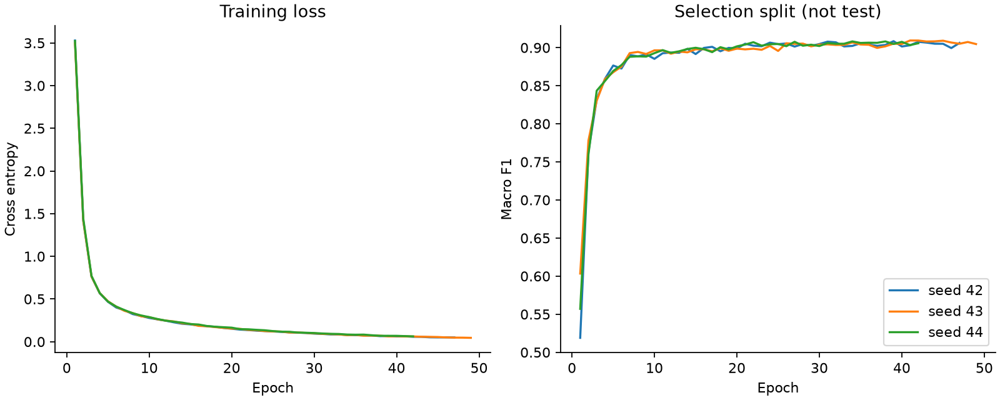

# 实验结果：英文客服意图识别

全部数值来自本机真实运行，模型和分流规则均在测试评估前确定。

## 数据与协议

官方数据：10,003 条训练文本、3,080 条测试文本、77 个意图。
规范化去重及去污染后划分：`{'train': 6962, 'selection': 1492, 'calibration': 1492, 'test': 3080}`。去除记录：`{'duplicate_train_rows_removed': 30, 'test_overlap_train_rows_removed': 25, 'conflicting_train_rows_removed': 2}`。
保留完整官方测试集。仅用测试输入的规范化文本做精确去污染，不用测试标签决定训练或模型选择。
词表仅在训练集拟合；预训练 MiniLM 全程冻结。模型选择集用于结构选择和早停，校准集用于温度与分流阈值。
选中隐藏层维度 `128`，基线 C=`4.0`；部署种子预定为 42。

## 测试集指标

| 模型 | Accuracy | Macro F1 | Top-3 accuracy |
|---|---:|---:|---:|
| TF-IDF + Logistic Regression | 0.8747 | 0.8749 | 0.9627 |
| MiniLM + PyTorch, seed 42 | 0.9195 | 0.9193 | 0.9802 |
| MiniLM + PyTorch, seed 43 | 0.9192 | 0.9190 | 0.9805 |
| MiniLM + PyTorch, seed 44 | 0.9185 | 0.9185 | 0.9812 |
| 三种子 mean ± sample SD | 0.9190 ± 0.0005 | 0.9189 ± 0.0004 | 0.9806 ± 0.0005 |

固定 seed 42 相对基线准确率差：**+4.48 个百分点**；按查询成对 bootstrap 的 95% 区间为 [+3.25, +5.58] 个百分点。
这个区间以已经训练好的模型为条件，不能表示训练随机性、未来分布变化或线上收益。三种子标准差单独报告。

## 置信度与人工分流

部署模型温度 T=1.3680，阈值=0.6000。
测试 NLL：0.3294 → 0.3069；ECE(15 bins)：0.0216 → 0.0187。
测试自动分流 2841/3080 条，覆盖率 **92.24%**，自动分流部分准确率 **95.56%**；其余交给人工。
自动分流准确率的 Wilson 95% 区间：`[0.9474440076125817, 0.9626242817722507]`。校准集 95% 的经验目标并非测试或线上保证，阈值本身也经过校准集搜索。
温度缩放不会改变 Top-1 类别；它只改变概率分布。图上的完整测试风险覆盖曲线仅供事后描述，没有用它重选阈值。

## 错误分析

`confusion_pairs.json` 汇总最常混淆的意图，`error_examples.json` 列出高置信度误判的 30 个真实例子。
数据样例归 PolyAI 原数据集所有，按 CC-BY-4.0 使用；来源和引用见 README。

## 边界

- 英文、银行客服、77 类闭集分类；未验证中文、其他行业或未知意图识别。
- 只训练小型 PyTorch 分类头，不是大语言模型微调，也不生成客服答案。
- 预训练模型使用的语料没有在本项目中独立审计，不能证明外部预训练不存在数据重叠。
- 去重训练协议与直接使用全部官方训练集的论文设置不同，不作榜单或 SOTA 比较。
- 推理性能只适用于报告中给出的设备、线程、批量和计时范围。

训练环境：`{'python': '3.12.14', 'torch': '2.14.1+cu130', 'device': 'cuda', 'gpu': 'NVIDIA GeForce RTX 5070 Ti Laptop GPU', 'torch_threads': 4}`；实验用时 37.6 秒（若有缓存会复用编码）。
